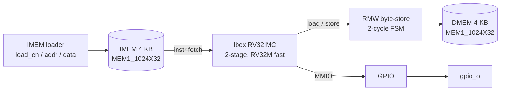

# RISC-V (Ibex) SoC with SRAM Macros — RTL to GDSII


-brightgreen)

A complete **RTL-to-GDSII** implementation of a small RISC-V SoC: the lowRISC **Ibex** core
(RV32IMC) with two **4 KB SRAM hard macros**, a byte-store read-modify-write path and GPIO.
The design was taken through **firmware-driven simulation, synthesis, equivalence checking,
floorplanning, power planning, CTS, routing, SPEF-based sign-off STA, IR-drop analysis and
physical verification (DRC/LVS)** with the Cadence flow on the 45 nm gsclib045 library.

A power-gated (UPF) version of this SoC is in **[ibex-lowpower-upf](https://github.com/nikshithashetty-lgtm/ibex-lowpower-upf)**.

---

## Highlights

| | Result |
|---|---|
| Verification | Self-checking C firmware test **PASS** in Xcelium (30,278 cycles) |
| Synthesis | Genus, 5 ns (200 MHz), hand-written SDC, ICG clock gating · Conformal LEC **PASS** |
| Clock tree | 1,926 sinks, NDR clock routing |
| Sign-off STA | Tempus (SPEF, OCV + CPPR + SI): setup **+102 ps**, hold **+19 ps**, 0 violations |
| Hold ECO | near-critical hold paths (< 20 ps) **1,618 → 26** |
| IR drop | Voltus static: worst **32 mV (3.0 % of VDD)**, 0 weak/disconnected nodes |
| DRC | Pegasus (572 rules): **0** in the implemented design |
| LVS | **91,282 / 91,282 devices**, **81 / 81 ports** matched (SRAMs black-boxed) |

---

## Architecture



| Region | Address |
|---|---|
| IMEM | `0x0000_0000` (boot at `0x80`) |
| DMEM | `0x0001_0000` |
| GPIO | `0x0002_0000` |

**Why the RMW block:** the SRAM macro has no byte-write enables, so byte/half-word stores
are done as a 2-cycle read-modify-write.

---

## Results

### Synthesis (Genus, slow corner 1.08 V / 125 °C, 5 ns)
- Hand-written SDC (clock, I/O delays, uncertainty 0.30 ns setup / 0.10 ns hold pre-CTS)
- ICG-based clock gating (`TLATNTSCAX2`) through the Ibex `prim_clock_gating` wrapper
- Conformal LEC: RTL ≡ gate netlist

### Physical design (Innovus, MMMC)

| Step | Details |
|---|---|
| Views | setup: slow 1.08 V / 125 °C + rc_worst · hold: fast 1.32 V / 0 °C + rc_best (QRC tech) |
| Floorplan | SRAMs at the left edge with 10 µm halos, core utilization ≈ 0.76 |
| Power grid | Metal11/Metal10 ring and stripes, Metal1 followpins, 2 µm Metal1 route blockage at SRAM edges |
| CTS | CCOpt, 1,926 sinks, non-default rule on clock nets |
| Route | SI-aware routing, antenna fixing, post-route optimization |

### Sign-off

| Check | Result |
|---|---|
| Tempus STA (SPEF, OCV + CPPR + SI, sign-off SDC 0.10 / 0.05 ns) | setup **+102 ps**, hold **+19 ps**, no max-tran / max-cap violations |
| Hold ECO | near-critical hold paths 1,618 → 26 (setup cost ~73 ps, accepted) |
| Voltus static IR | worst effective instance voltage 1.048 V (**32 mV, 3.0 %**) |
| Pegasus DRC | 0 in the implemented design (31 stacked-via violations fixed by ECO) |
| Pegasus LVS | 91,282 / 91,282 devices, 81 / 81 ports |

> **Limitations (documented honestly):** the SRAM macros come without GDS, so they are black
> boxes. Their pin interface cannot be fully verified in LVS (net mismatches remain only at the
> SRAM pins), two VIA2.E.3 results at the SRAM VDD hook-up are IP waivers, and the SRAM `.lib`
> has placeholder leakage (power numbers exclude the SRAMs).

---

## Repository layout

```
.
├── rtl/           ibex_soc.sv (SoC wrapper, RMW, GPIO), tech/ (ICG wrapper)
├── sw/            crt0.S, link.ld, test.c, Makefile, bin2hex.py
├── sim/           testbench, file list, run scripts, waveform setup
├── constraints/   SDC (implementation + sign-off)
├── scripts/       setup.tcl (all paths), ibex_files.tcl (file list)
├── syn/           Genus synthesis scripts
├── pnr/           Innovus scripts (floorplan → route, ECOs, extraction, stream) + Python helpers
├── sta/           Tempus sign-off scripts
├── ir/            Voltus power-pad files
└── pv/drc/        DRC result parser (drc_xy.py)
```

The Ibex core itself is lowRISC's open-source code (Apache-2.0) and is not copied here.

---

## How to run

Requires Cadence Xcelium, Genus, Conformal, Innovus, Quantus, Tempus, Voltus, Pegasus, the
gsclib045 45 nm library and the RISC-V GCC toolchain. Edit the paths in `scripts/setup.tcl` first.

```bash
cd sw   && make                                  # build the firmware hex
cd sim  && ./run_sim.csh                         # firmware test in Xcelium
cd syn  && genus -files <synthesis script>.tcl   # synthesis
cd pnr  && innovus -stylus -files run_to_place.tcl
           innovus -stylus -files run_cts_route.tcl
           innovus -stylus -files eco.tcl        # hold ECO
           innovus -stylus -files extract.tcl    # SPEF
cd sta  && tempus -stylus -files sta.tcl         # sign-off STA
```

---

## Roadmap

- [x] RTL integration + firmware test (Xcelium)
- [x] Synthesis + Conformal LEC
- [x] Floorplan, power grid, CTS, routing (Innovus MMMC)
- [x] Sign-off STA with OCV / CPPR / SI + hold ECO
- [x] Static IR drop (Voltus)
- [x] DRC / LVS (Pegasus)
- [x] Power-gated version with UPF → [ibex-lowpower-upf](https://github.com/nikshithashetty-lgtm/ibex-lowpower-upf)
- [ ] Custom standard cells (Virtuoso + Liberate) used in this flow
- [ ] Analog hard macro (LDO) integration
- [ ] Full LVS with real SRAM layout

---

## Lessons learned

- **Power-grid fixes belong in power planning:** a post-route followpin fix created 214 shorts; a 2 µm Metal1 blockage at the SRAM edges during power planning solved it cleanly.
- **Router-clean is not sign-off-clean:** stacked offset 2-cut vias passed Innovus but failed Pegasus VIAk rules; capping 24 nets at Metal5 fixed them.
- **Hold costs setup:** the hold ECO cost ~73 ps of setup, so hold is only fixed where setup has margin.
- **Trust sign-off:** Innovus timing was optimistic compared with Tempus on extracted SPEF with SI.
- **Check the stream layer map:** a map missing Metal10/11 silently removed the whole power grid from the GDS.
- **LVS bring-up is its own project:** label texttypes, top-level PG labels, CDL device names and black-box pins all had to be fixed.

---

## Contributors

| Name | Role |
|---|---|
| **Nikshitha N Shetty** ([@nikshithashetty-lgtm](https://github.com/nikshithashetty-lgtm)) | SoC integration, firmware test, synthesis, physical design and sign-off |

M.E. VLSI, Manipal School of Information Sciences (MSIS), Manipal.

## License

Scripts and RTL written for this project may be reused with attribution. The gsclib045 library,
SRAM macros and Cadence tools are **not** included and are subject to their own licenses.
